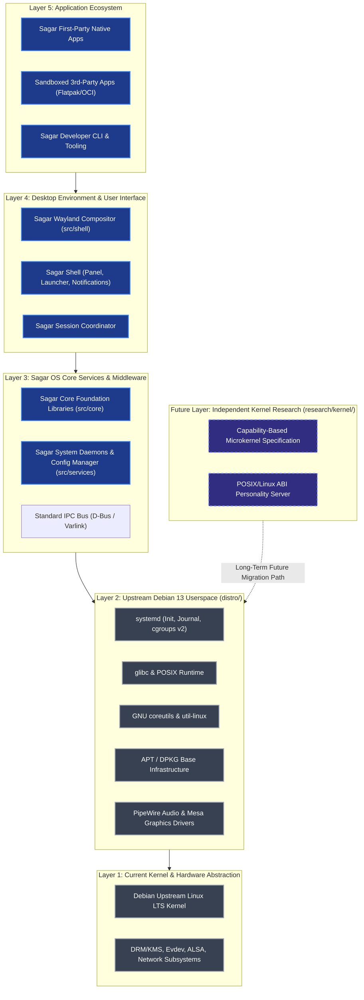
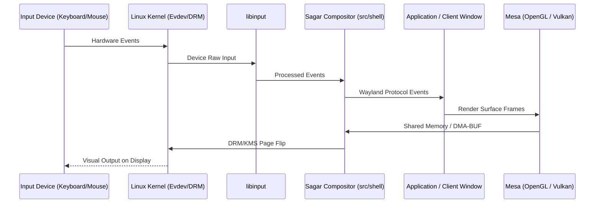

# ARCHITECTURE.md — Sagar OS Architectural Blueprint

> **System Architecture, Subsystem Boundaries, and Long-Term Evolution Strategy.**

---

## 1. High-Level Architecture Overview

Sagar OS employs a modular, layered systems architecture. The architecture is deliberately divided into the **Debian Upstream Foundation**, the **Sagar OS Custom Userspace**, and the **Kernel Evolution Pathway**.



---

## 2. Component Boundary Specification

Maintaining a clean architectural separation guarantees that upstream Debian packages can be updated without breaking Sagar OS custom functionality, and that Sagar OS components remain portable and testable.

### 2.1 Upstream Debian 13 Components
These components are sourced directly from Debian 13 ("Trixie") repositories and are maintained via standard packaging mechanisms:
- **Kernel & Firmware:** Linux LTS, `linux-image-*`, firmware packages (`firmware-linux-free`, `firmware-misc-nonfree`).
- **Initialization & System Bus:** `systemd`, `systemd-logind`, `dbus-daemon` / `dbus-broker`.
- **System C Library & Runtimes:** `glibc`, `libstdc++`, Python 3 base.
- **Hardware Drivers & Multimedia Pipeline:** Mesa drivers (RADV, ANV, Iris), `libdrm`, `PipeWire`, `WirePlumber`, `libinput`.
- **Package Management:** `dpkg`, `apt`.

### 2.2 Sagar OS Custom Components (`src/`)
These components are developed within this repository and represent the unique value of Sagar OS:
- **`src/core/` (Sagar Core):** Shared C/Rust foundational utilities, configuration parsers, hardware queries, logging facades, and security abstractions.
- **`src/services/` (Sagar System Services):** Lightweight, unprivileged and privileged system daemons providing unified system configuration, user profiles, power management policies, and system status coordination.
- **`src/shell/` (Sagar Wayland Compositor & Shell):** Custom Wayland compositor leveraging `wlroots` or modern Rust Wayland primitives, providing a responsive, tear-free windowing and workspace experience.
- **`src/apps/` (Sagar First-Party Applications):** Cohesive, aesthetic, and fast system utilities (e.g., Settings, File Manager, Terminal, System Monitor) adhering strictly to Sagar OS design principles.

---

## 3. Subsystem Interaction Architecture

### 3.1 Display and Input Pipeline


### 3.2 Service and IPC Model
- **Inter-Process Communication:** Inter-service communication relies on standardized D-Bus and Varlink interfaces.
- **Privilege Separation:**
  - High-privilege tasks (disk operations, network interface reconfiguration, system updates) are handled by dedicated systemd-supervised worker services.
  - User interface components and user sessions run strictly under unprivileged user sessions.
  - Privileged actions requested by user sessions require PolicyKit (`polkit`) authorization checks.

---

## 4. State, Configuration, and File System Layout

Sagar OS enforces a stateless configuration paradigm:

```text
/
├── usr/                  # Immutable distribution code, binaries, libraries
│   ├── bin/              # Upstream and Sagar OS binaries
│   ├── lib/              # Shared libraries and default configs (/usr/lib/sagar/)
│   └── share/            # Desktop files, assets, themes
├── etc/                  # Host-specific mutable overrides (empty by default)
├── var/                  # Variable runtime data, package cache, system logs
├── home/                 # User persistent data, applications, and settings (~/.config)
└── run/                  # Volatile runtime state (tmpfs)
```

1. **Vendor Defaults vs. User Overrides:** Default configurations live in `/usr/lib/sagar/` or `/usr/share/sagar/`. `/etc/` is reserved strictly for local administrator overrides.
2. **Crash Resilience:** If `/etc` is wiped, the system automatically falls back to vendor defaults and boots cleanly into a functioning state.

---

## 5. Long-Term Kernel Evolution Strategy

### 5.1 The Strategic Problem with Monolithic Kernels
Monolithic kernels place device drivers, network stacks, filesystems, and core scheduling in the same privileged execution ring (`Ring 0`). A single driver bug can panic the entire system or introduce catastrophic security vulnerabilities.

### 5.2 The Sagar OS Microkernel Vision
Our long-term architectural goal is a capability-based microkernel:
- **Core Microkernel (Ring 0):** Responsible *only* for thread scheduling, memory address space mapping, and capability-based inter-process communication (IPC).
- **User-Space Drivers (Ring 3):** File systems, device drivers, and network stacks run as isolated processes in unprivileged user space.
- **POSIX / Linux Compatibility Layer:** An execution server that translates Linux system calls into microkernel IPC messages, allowing Sagar OS userspace binaries (`src/core`, `src/services`, `src/shell`) to run without source-level rewrites.

### 5.3 Research Isolation Rule
All specifications, formal verification models, and prototype code relating to the custom kernel are quarantined in [`research/kernel/`](research/kernel/). Under no circumstances should build scripts or release manifests attempt to link or boot this experimental code in production Sagar OS Debian 13 images.
