# Product Scope & Boundaries — Sagar OS

> **Clear boundaries defining what Sagar OS builds, what is inherited from Debian 13, and what is intentionally excluded.**

---

## 1. Product Scope Matrix

```mermaid
flowchart TD
    subgraph InScope["In-Scope (Sagar OS Core Team)"]
        direction TB
        CustomShell["Sagar Desktop Shell (src/desktop)"]
        CustomCompositor["Wayland Graphics Server (src/graphics)"]
        CustomDaemons["Sagar System Services (src/services)"]
        CustomCore["Foundation Libraries (src/core, src/libraries)"]
        CustomApps["First-Party Apps (src/apps)"]
        DistroEng["Debian 13 Rootfs Harness & Overlays (distro/)"]
    end

    subgraph Upstream["Upstream Scope (Debian 13 Trixie)"]
        direction TB
        LinuxKernel["Linux LTS Kernel & Hardware Drivers"]
        BaseUserspace["glibc, systemd, GNU coreutils"]
        BasePackages["Debian Package Archive (APT)"]
        GraphicsDrivers["Mesa, libdrm, libinput"]
    end

    subgraph OutOfScope["Out of Scope (Explicitly Excluded)"]
        direction TB
        AdTelemetry["Telemetry, Tracking, Cloud User Accounts"]
        Bloatware["Third-Party Sponsored Applications"]
        X11Server["Legacy Monolithic X11 Display Server"]
        ProprietaryLock["Proprietary Walled-Garden App Stores"]
    end
```

---

## 2. In-Scope Product Deliverables

### 2.1 Display Server & Compositor (`src/graphics/`)
- Pure Wayland compositor providing hardware-accelerated surface rendering, output management, fractional scaling, and multi-monitor management.
- Wayland protocol extension definitions (`src/graphics/protocols/`).

### 2.2 Desktop Shell Environment (`src/desktop/`)
- Integrated desktop status panel with clock, system status, workspace switcher, and hardware indicators.
- Keyboard-driven application launcher and system command runner.
- Notification daemon and session lock screen.

### 2.3 System Services & Middleware (`src/services/`)
- Unified configuration daemon (`sagar-configd`) managing system state via D-Bus / Varlink.
- Session supervisor (`sagar-sessiond`) managing user lifecycle, display manager integration, and polkit authorization.
- Device power policy daemon (`sagar-powerd`).

### 2.4 First-Party Native Applications (`src/apps/`)
- Native Settings Control Center.
- High-performance Terminal Emulator.
- Fast, secure File Manager.
- Lightweight System Performance & Resource Monitor.

### 2.5 Distribution & Packaging (`distro/`)
- Minimal Debian 13 root filesystem profiles and package manifests (`distro/manifests/`).
- Bootloader configurations, Plymouth themes, and installer modules (`distro/boot/`, `distro/installer/`).
- Debian source package control files (`distro/packages/`).

---

## 3. Upstream Scope (Inherited from Debian 13)

Sagar OS does **not** duplicate upstream engineering. We rely on Debian 13 for:
- The Linux LTS kernel and hardware enablement drivers.
- GNU C Library (`glibc`) and core POSIX userspace.
- `systemd` init and service supervisor.
- Mesa graphics drivers (RADV, ANV, Iris) and `PipeWire` audio subsystem.
- Standard Debian APT package repository infrastructure.

---

## 4. Out-of-Scope (Explicit Non-Goals)

1. **No Cloud Account Lock-in:** The operating system will never require an online account to boot, log in, or operate.
2. **No Bundled Bloatware:** Sagar OS will not bundle sponsored games, trialware, or unrequested third-party apps.
3. **No Native X11 Server:** Native X11 display server support is deprecated and out-of-scope. Xwayland is provided purely as an isolated compatibility fallback.
4. **No Premature Custom Kernel:** The production distribution will not run an experimental custom kernel. Custom kernel work is strictly isolated in `research/kernel/` until Phase 5.
