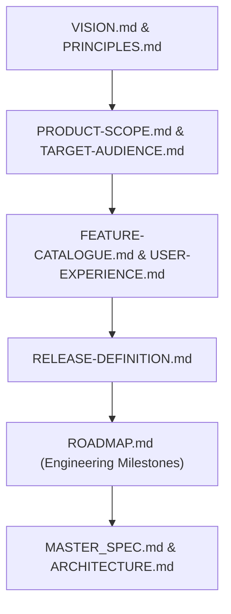

# Sagar OS Product Documentation (`docs/product/`)

> **Authoritative product specifications, user personas, design principles, and release definitions for Sagar OS.**

---

## 1. Overview

While the root documentation (`MASTER_SPEC.md`, `ARCHITECTURE.md`) defines the technical and engineering architecture of Sagar OS, the **Product Documentation Suite** articulates *what* Sagar OS delivers to users, *why* it is designed this way, *who* it is built for, and *how* features are phased across product releases.

---

## 2. Product Documentation Index

```text
docs/product/
├── README.md               # Product documentation index and navigation
├── VISION.md               # Long-term product vision and core value proposition
├── PRINCIPLES.md           # Product design philosophy and operational tenets
├── TARGET-AUDIENCE.md      # User personas, use cases, and pain points
├── PRODUCT-SCOPE.md        # In-scope vs. out-of-scope boundaries and upstream division
├── FEATURE-CATALOGUE.md    # Exhaustive catalogue of planned user-facing and system features
├── USER-EXPERIENCE.md      # UX/UI design language, interaction paradigms, and ergonomics
└── RELEASE-DEFINITION.md   # Release criteria, versioning tiers, and milestone deliverables
```

---

## 3. Relationship to Engineering Specifications



- **Product Specifications (This Directory):** Define the user experience, capability catalogue, release scope, and design language.
- **Engineering Specifications (`docs/specs/`, `MASTER_SPEC.md`):** Define the technical protocols, D-Bus interfaces, C/Rust APIs, and system parameters required to implement the product features.
- **Architectural Decision Records (`docs/adr/`):** Capture rationale, trade-offs, and consensus for technical and product decisions.
