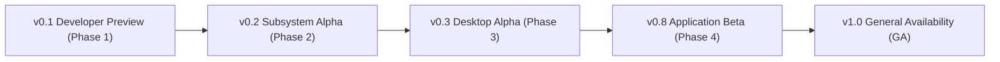

# Release Definitions & Versioning — Sagar OS

> **Release tiers, version milestones, and feature delivery criteria for Sagar OS.**

---

## 1. Versioning Strategy

Sagar OS follows Semantic Versioning for its custom components, coupled with milestone-driven operating system release tiers:

---

## 2. Release Milestones & Exit Deliverables

### Milestone 1: v0.1 Developer Preview (Phase 1)
- **Target Audience:** Core contributors, distribution engineers, testers.
- **Deliverables:**
  - Minimal reproducible Debian 13 rootfs generated via `tools/build/build-rootfs.sh`.
  - Bootable UEFI hybrid ISO/QCOW2 disk image.
  - Automated headless QEMU boot test in CI (`tests/vm/`).
- **Exit Criteria:**
  - System boots to a clean login prompt in QEMU within 5 seconds.
  - Bit-for-bit reproducible rootfs build.

---

### Milestone 2: v0.2 Subsystem Preview (Phase 2)
- **Target Audience:** Systems engineers, daemon authors.
- **Deliverables:**
  - `libsagar-core` foundation library and `src/libraries/`.
  - Sagar system services (`sagar-configd`, `sagar-sessiond`, `sagar-powerd`).
  - Stateless vendor default configurations in `/usr/lib/sagar/`.
  - Initial Debian `.deb` package generation recipes in `distro/packages/`.
- **Exit Criteria:**
  - Services launch cleanly under systemd with zero failed units.
  - Configuration daemon successfully responds to D-Bus / Varlink queries.

---

### Milestone 3: v0.3 Desktop Alpha (Phase 3)
- **Target Audience:** Early adopters, UI testers, developers.
- **Deliverables:**
  - Hardware-accelerated Wayland display server (`src/graphics/`).
  - Sagar desktop shell (`src/desktop/`): status panel, launcher, notification toast, lock screen.
  - Multi-monitor output arrangement and fractional scaling.
- **Exit Criteria:**
  - 60+ FPS tear-free rendering on Intel, AMD, and VirtIO-GPU hardware.
  - Full keyboard-first navigation and launcher response in under 50ms.

---

### Milestone 4: v0.8 Application Beta (Phase 4)
- **Target Audience:** Power users seeking a daily-driver operating system.
- **Deliverables:**
  - Native first-party apps (`src/apps/`): Settings, Terminal, Files, Monitor.
  - Landlock LSM application sandboxing profiles.
  - Seamless Flatpak integration for third-party software.
  - Calamares live installer integration (`distro/installer/`).
- **Exit Criteria:**
  - Full daily-driver hardware viability (Wi-Fi, Bluetooth, Audio sink switching, Suspend/Resume).
  - Security sandbox enforcement verified via `tests/security/`.

---

### Milestone 5: v1.0 General Availability (GA)
- **Target Audience:** General public, software developers, privacy-conscious professionals.
- **Deliverables:**
  - Production-hardened Sagar OS installation media for x86_64 and AArch64.
  - Signed package repositories and official update channels.
  - Comprehensive end-user documentation and user guides.
- **Exit Criteria:**
  - Zero critical CVEs in base packages.
  - End-to-end automated installation and boot pass in CI.
  - Formal sign-off on performance, stability, and zero-telemetry verification.

---

### Horizon 2: Future Research Releases (Phase 5)
- **Target Audience:** Systems researchers, microkernel specialists.
- **Deliverables:**
  - Experimental capability-based microkernel prototypes in `research/kernel/`.
  - Virtualized QEMU boot test and POSIX/Linux personality server benchmark reports.
- **Quarantine Rule:**
  - Completely decoupled from production v1.0 Debian 13 release media.
