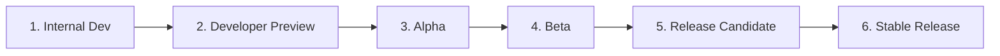
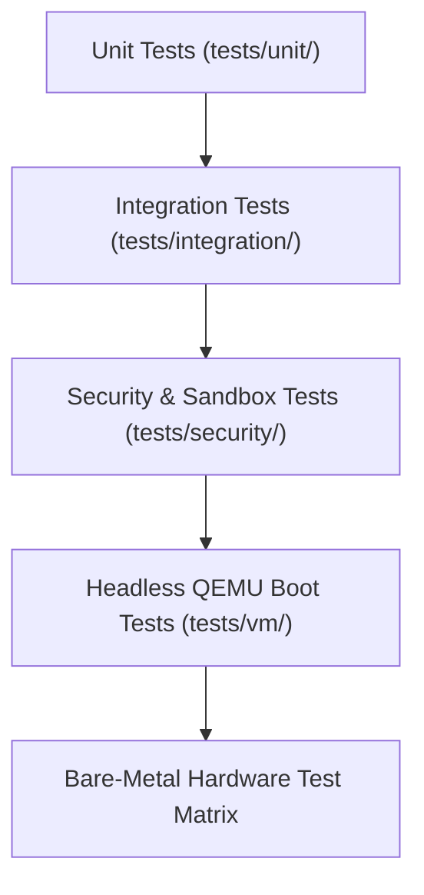

# Release Strategy & Quality Definition — Sagar OS

> **Defining the release lifecycle, stage boundaries, quality thresholds, and readiness criteria for Sagar OS.**

---

## 1. Release Strategy Overview

Sagar OS follows a disciplined, quality-gated release strategy designed to transition the operating system from architectural inception into a mature, dependable, daily-driver desktop platform.

Rather than adhering to arbitrary calendar deadlines, releases are strictly milestone-driven: a release stage advances only when its explicit quality gates, verification tests, and stability requirements are fully satisfied. The strategy ensures that the project’s core promises—**Beautiful, Fast, and Capable**, built on a rock-solid **Debian GNU/Linux 13 ("Trixie")** baseline—are rigorously validated at each stage before reaching broader audiences.

> *Note: Release stages and version designations described in this document represent the proposed release framework submitted for product governance review, rather than finalized commercial commitments.*

---

## 2. Versioning Policy

Sagar OS intends to employ a dual-track versioning model:

1. **Operating System Platform Milestones:** Named developmental stages (e.g., *Developer Preview*, *Alpha*, *Beta*, *Release Candidate*, and *Stable Release*) reflecting overall system maturity and daily-driver readiness.
2. **Component Semantic Versioning (`MAJOR.MINOR.PATCH`):** Individual first-party components (such as foundation libraries, system daemons, graphics compositor, and first-party applications) follow standard Semantic Versioning:
   - `MAJOR`: Incompatible API, IPC contract, or protocol changes.
   - `MINOR`: Backwards-compatible functionality additions.
   - `PATCH`: Backwards-compatible bug fixes and security patches.

---

## 3. Development and Release Stages

### 3.1 Stage 1: Internal Development
- **Focus:** Foundational architecture, package manifest definitions, rootfs assembly tooling, and core library design.
- **Audience:** Core maintainers and direct contributors only.
- **Stability Expectation:** Highly volatile; interfaces, directory layouts, and build recipes change frequently. Not suitable for end-user deployment.

### 3.2 Stage 2: Developer Preview
- **Focus:** Minimal bootable system images, core system daemons, and basic hardware initialization.
- **Audience:** Systems developers, package maintainers, and platform engineers.
- **Stability Expectation:** Command-line and basic headless environment booting in virtualized environments (QEMU); validates the integrity of the Debian 13 baseline and custom service supervision.

### 3.3 Stage 3: Alpha
- **Focus:** Integration of the custom Wayland graphics server (`src/graphics/`) and desktop shell (`src/desktop/`).
- **Audience:** Early adopters, UI testers, and technical enthusiasts.
- **Stability Expectation:** Graphical session functional; core window management, panel, and launcher operative; transient visual bugs or incomplete edge cases expected.

### 3.4 Stage 4: Beta
- **Focus:** First-party application suite integration (`src/apps/`), sandboxing policies, installer integration, and wide hardware validation.
- **Audience:** Power users, productivity workers, and community testers testing on bare-metal hardware.
- **Stability Expectation:** Feature complete for the target milestone; daily-driver viability tested; remaining focus is on bug fixing, power efficiency, and polish.

### 3.5 Stage 5: Release Candidate (RC)
- **Focus:** Zero known critical bugs, final visual asset freeze, security verification, and release installer testing.
- **Audience:** Broad community testing.
- **Stability Expectation:** Code and feature freeze; changes restricted strictly to critical regression and security fixes.

### 3.6 Stage 6: Stable Release (General Availability)
- **Focus:** Production-grade installation media, signed package repository channels, and end-user documentation.
- **Audience:** General desktop users, developers, and professionals.
- **Stability Expectation:** Rock-solid stability; verified sleep/wake, multi-monitor, and audio performance; long-term security patching supported via the Debian 13 LTS baseline.

---

## 4. Initial Release Goals

The initial public release milestone of Sagar OS focuses on delivering a cohesive, distraction-free daily driver rather than attempting to ship every conceivable utility:

1. **Bootable Stability:** A bootable live and installable hybrid UEFI image that installs cleanly to bare-metal storage.
2. **Fluid Desktop Environment:** A hardware-accelerated Wayland session maintaining 60+ FPS without screen tearing or visual artifacts.
3. **Core Utility Suite:** A focused set of reliable native utilities (Settings, Terminal, File Manager, and System Monitor).
4. **Clean Baseline:** Pristine separation between upstream Debian 13 packages and Sagar OS custom components, with zero bundled telemetry or bloatware.

---

## 5. Release Scope and Feature Inclusion

To prevent release slippage, features are phased across release tiers:

| Subsystem | Included in Initial Stable Release | Deferred to Subsequent Releases |
| :--- | :--- | :--- |
| **Display & Compositor** | Wayland native composition, multi-monitor, fractional scaling, isolated Xwayland. | Advanced color management (ICC/HDR), VRR edge cases. |
| **Desktop Shell** | Status panel, central launcher, workspace switcher, notification toasts, lock screen. | Full-screen spatial overview, dynamic widget extensions. |
| **System Services** | Unified Configuration Service, Session Management Service, Adaptive Power Service, audio routing. | Local peer-to-peer file sharing protocol. |
| **Applications** | Settings Control Center, Terminal, File Manager, System Monitor. | First-party creative editors or specialized office suites. |
| **Packaging & Delivery** | Minimal Debian 13 rootfs, Flatpak sandboxed application runtime support. | Curated graphical App Store GUI (planned for subsequent phase). |
| **Kernel Exploration** | Debian-supported upstream Linux LTS kernel. | Independent microkernel prototypes (quarantined in `research/kernel/`). |

---

## 6. Quality and Stability Expectations

A release cannot be promoted to Stable until it satisfies unambiguous quality benchmarks:
- **Zero Unhandled Crashes:** No unhandled crashes or panics in the desktop compositor, session manager, or system configuration daemons during standard usage.
- **Session Recovery:** In the event of an unexpected display server crash, the session manager must restore user windows or cleanly exit without corrupting system state.
- **Stateless Resilience:** Complete removal or corruption of `/etc` local configurations must not prevent the operating system from booting back into a functional factory default desktop.

---

## 7. Hardware Compatibility Expectations

Sagar OS relies on upstream Debian 13 Linux LTS kernel and Mesa driver stacks for hardware enablement. 

- **Tier-1 Target Platforms (Formally Verified):**
  - Modern `x86_64` (AMD64) UEFI systems with Intel, AMD, or contemporary ARM64 graphics hardware.
  - Standard multi-touch trackpads, USB/Bluetooth mice, standard audio jacks, and USB-C display outputs.
- **Tier-2 Target Platforms (Community Verified):**
  - `aarch64` (64-bit ARM) standard UEFI/ACPI laptops and reference developer boards.
- **Explicit Compatibility Reality:**
  - Sagar OS makes **no claim of universal hardware support**. Highly proprietary legacy devices, closed-source legacy peripherals, or non-standard laptop power controllers are not guaranteed to operate out-of-the-box.

---

## 8. Performance Expectations

Sagar OS establishes the following target performance objectives:
- **Idle Memory Ceiling:** Base operating system (kernel, systemd, background services, and idle desktop shell) must target an agreed lean memory ceiling at cold boot (numerical target pending formal calibration).
- **Input & Display Latency (Target Performance Objective):** Target input-to-screen response within a single display frame (<16ms on a 60 Hz display).
- **Wake From Sleep (Target Performance Objective):** Target resumption from laptop sleep to an active, responsive lock screen in under 2 seconds on Tier-1 reference hardware.
- **Storage Footprint:** Minimal base rootfs image footprint adhering strictly to the curated Debian 13 package manifest.

---

## 9. Security and Reliability Requirements

- **Privacy Invariant:** Complete absence of commercial telemetry, analytics collectors, tracking pings, or forced cloud sign-in services.
- **Default-Drop Network Invariant:** Default-drop inbound network firewall active by default, blocking unsolicited inbound network connections (technical architecture detailed in [MASTER_SPEC.md](../../MASTER_SPEC.md)).
- **Privilege Boundary Invariant:** System-level hardware configuration services execute with minimal privileges; administrative tasks require explicit user authorization.
- **Application Isolation:** First-party and third-party desktop applications execute under application process sandboxing profiles (see [MASTER_SPEC.md](../../MASTER_SPEC.md)).

---

## 10. Testing and Validation Framework

Progression through release stages requires passing an automated and human verification pipeline:

1. **Automated CI Validation:** Unit test passes for libraries, D-Bus schema contract validation, and headless QEMU boot smoke testing on every build.
2. **Automated VM Boot Matrix:** Verifies that generated ISO images boot cleanly to multi-user target and graphical shell within 5 seconds in virtualized environments.
3. **Bare-Metal Test Matrix:** Manual and automated testing across representative Intel, AMD, and ARM reference laptops validating sleep/wake, Wi-Fi, audio, and external displays.

---

## 11. User Feedback and Issue Reporting

- **Local-First Crash Diagnostics:** When an application crashes, detailed diagnostic logs are generated locally on the machine for user inspection.
- **Transparent Issue Tracking:** Public, transparent bug reporting and issue tracking without automated background crash-dump uploads.
- **Clear Reproduction Criteria:** Issue templates requiring explicit reproduction steps, hardware specifications, and system package versions.

---

## 12. Post-Release Maintenance

Following the launch of a Stable Release:
- **Security Patches:** Upstream Debian 13 security updates are synchronized and released through signed repository channels.
- **Bug Fix Releases:** Point updates (`PATCH` releases) resolve verified regressions without introducing breaking interface or workflow changes.
- **Update Safety:** Updates are applied non-destructively; the operating system must never force a restart while the user is actively working.

---

## 13. Future Release Evolution

Beyond the initial stable milestone, future release cycles will systematically address:
- **Phase 5 Independent Microkernel Research:** Long-term capability-based microkernel prototypes quarantined in `research/kernel/`, progressing through academic evaluation before any production consideration.
- **Advanced Ecosystem Expansion:** Expanded accessibility services, enhanced power management heuristics, and curated graphical application discovery.

---

## 14. Release Readiness Criteria

A release candidate may only be promoted to a Stable Release when all of the following conditions are formally certified:

- [ ] All Tier-1 automated CI test suites (`tests/unit/`, `tests/integration/`, `tests/security/`, `tests/vm/`) pass with zero errors.
- [ ] Automated QEMU boot test verifies boot-to-login time under 5 seconds.
- [ ] Zero open critical or high-severity CVEs in the base package manifest.
- [ ] Hardware test matrix certifies functional sleep/wake, Wi-Fi, audio, and multi-monitor output on Tier-1 reference devices.
- [ ] Zero telemetry audit certifies no unrequested network packets are transmitted during idle or standard operations.
- [ ] End-user documentation and offline help guides are complete and verified.

---

## 15. Open Release Decisions Requiring Approval

The following release strategy proposals are submitted for product owner review and formal approval:

1. **Formal Release Version Naming Scheme:** Confirm whether the initial public milestone will be designated as `Sagar OS 1.0` or preceded by numbered public previews (e.g., `0.1 Developer Preview`, `0.5 Public Beta`).
2. **Release Channel Cadence:** Decide the frequency and cadence of point updates (e.g., continuous rolling point updates vs. scheduled bi-monthly maintenance updates).
3. **Package Repository Infrastructure Hosting:** Confirm the hosting model and signing key infrastructure for official Sagar OS Debian package repositories.

---

## 16. Unresolved Dependencies

1. **Debian 13 ("Trixie") Official Release Timing:** The production baseline depends on upstream Debian 13 release milestones and archive freezing schedules.
2. **Live Installer Framework Selection:** A formal decision is required on the live installer engine (e.g., Calamares module customization vs. debian-installer automated preseed).

---

## 17. Criteria Established Before Declaring a Stable Release

Before any build of Sagar OS may officially carry the designation of a **Stable Release**, the following three non-negotiable milestones must be established:
1. **Daily-Driver Hardware Validation:** Verified proof that a user can run Sagar OS on reference laptops for daily productivity without encountering system freezes, audio dropouts, or sleep/wake failures.
2. **Deterministic Build Reproducibility:** Verified proof that the release rootfs and ISO images can be rebuilt bit-for-bit from source manifests without external unversioned dependencies.
3. **Recovery & Reset Certification:** Verified proof that a corrupted user configuration can be restored cleanly to factory defaults without losing personal home-directory documents.
