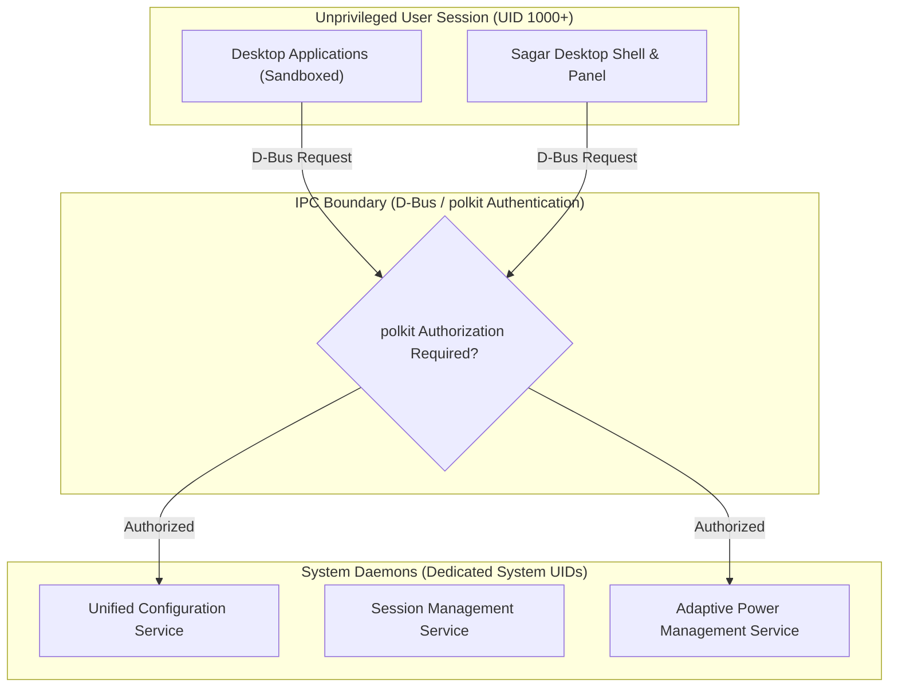

# Secure Development & Privilege Boundary Standards — Sagar OS

> **Security principles, privilege boundaries, secure coding practices, memory safety hardening, and sandboxing requirements for Sagar OS.**

---

## 1. Security Architecture Principles

All software developed for Sagar OS must adhere to five fundamental security principles:

1. **Principle of Least Privilege:** Every process, daemon, and session must execute with the absolute minimum set of privileges necessary to accomplish its function.
2. **Defense in Depth:** Security must not rely on a single defensive layer. Process sandboxing, Mandatory Access Control (MAC), and memory hardening must operate concurrently.
3. **Fail-Safe Defaults:** If a permission check, network rule, or configuration parse fails, the system must fail closed and reject the operation.
4. **Complete Mediation:** Every access attempt to a protected resource (hardware device, privileged IPC method, private directory) must be checked and authorized every single time.
5. **Separation of Privileges:** Privileged hardware mutations are isolated from unprivileged desktop graphical user interfaces.

---

## 2. Privilege Boundaries & Service Separation



- **No Graphical Roots:** Graphical user interface applications must **never run as `root` (UID 0)**.
- **Dedicated System Accounts:** Background daemons must run under dedicated system users/groups (e.g., `_sagar-config`), not as root, unless raw hardware manipulation strictly requires it.
- **Polkit Authorization:** Administrative actions requested by the user session (modifying network settings, shutting down the machine, installing system updates) require explicit authorization through PolicyKit (`polkit`).

---

## 3. Secure Coding Practices

### 3.1 Input Validation & Sanitization
- All data originating outside the immediate process boundary (IPC parameters, file contents, environment variables, command-line flags) must be treated as untrusted.
- Validate types, lengths, ranges, and characters before processing:
  - Reject paths containing directory traversal sequences (`..`).
  - Validate numeric inputs against integer overflow bounds before allocation.
  - Sanitize string inputs to prevent format-string or command-injection vulnerabilities.

### 3.2 Compiler Hardening Flags (C)
All C code compiled for Sagar OS must be built with standard security hardening flags:
```text
-fstack-protector-strong
-D_FORTIFY_SOURCE=2
-fPIE -pie
-Wl,-z,relro,-z,now
-Wl,-z,noexecstack
```

### 3.3 Memory Safety & Secret Handling
- **Memory Zeroing:** Sensitive buffers (cryptographic keys, passwords, authentication tokens) must be cleared immediately after use using `explicit_bzero()` or `memset_s()` to prevent secrets from lingering in memory dumps or swap.
- **No Hardcoded Secrets:** Cryptographic keys, tokens, or default credentials must never be committed to source code or git history.
- **Buffer Safety:** Unbounded string or buffer functions (`strcpy`, `sprintf`, `gets`) are strictly forbidden. Always use length-bounded variants (`snprintf`, `strlcpy`).

---

## 4. Application Sandboxing Requirements

Applications executed within Sagar OS must be isolated to prevent compromise of user data:
- **Filesystem Isolation:** Application sandboxing must enforce Landlock LSM restrictions, granting write access only to explicit user-selected folders and isolated sandbox data directories.
- **Syscall Filtering:** Utilize `seccomp-bpf` to filter dangerous or obsolete kernel syscalls (`ptrace`, raw socket creation, kernel module loading) from application processes.
- **Device Isolation:** Direct device node access (webcams, raw audio devices, input devices) is gated behind portal permissions and cannot be opened directly by untrusted client processes.
